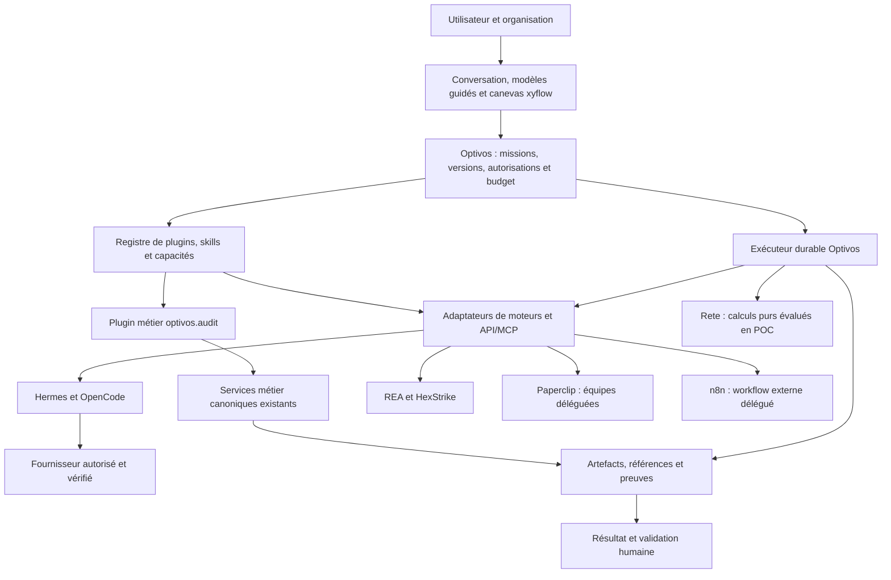

# Optivos — plan directeur de la plateforme

Date : 16 octobre 2026. Direction demandée par l’utilisateur ; architecture cible, pas déclaration de disponibilité.

MISSION: analyser l’existant, structurer la plateforme, cadrer l’audit en plugin et préparer le système nodal avant toute nouvelle construction.
AFFECTED DOMAIN: architecture produit, gouvernance et skills de développement.
CANONICAL OWNER: services métier existants pour l’audit ; Auth/Organization/Company et RLS inchangés ; agent-workspace pour le socle expérimental.
CURRENT STATUS: planification. Le socle multi-moteurs existe en Preview ; plugin audit, canevas nodal et exécution de graphes ne sont pas implémentés.
FILES EXPECTED: présent plan, comparaison nodale, contrat du plugin audit, ADR, index d’architecture, routage AGENTS et quatre skills avec un inventaire déterministe.
DB IMPACT: aucun ; schémas futurs à concevoir avant migration.
SECURITY IMPACT: aucun droit ni connecteur activé ; contrats et étapes de validation documentés.
TEST PLAN: valider les skills et leurs liens, exécuter l’inventaire local, vérifier le périmètre documentaire et l’absence de modification applicative.
OUT-OF-SCOPE: installation de bibliothèques, canevas simulé, nouveau moteur métier, déploiement de services, migration et inférence payante.

## 1. Produit et rôles

Optivos devient le poste commun pour comprendre une entreprise, définir un objectif, construire un parcours visuel, mobiliser des agents/outils et valider les résultats. Conversation, modèle guidé et construction manuelle sont trois entrées vers la même mission. Les vues simple et avancée affichent le même graphe ; elles ne créent ni copies de workflow ni runtimes distincts.

L’audit complet devient un **plugin métier propriétaire de premier niveau et facultatif**, `optivos.audit`, accompagné de skills de méthode. Il encapsule l’accès aux modules existants : entreprise, découverte, entretiens, connaissances, processus, analyse, opportunités, ROI, recommandations, blueprint et résultat. Un prompt ou une skill ne remplace aucun calcul ou service de ce parcours. La désactivation future du plugin dans l’interface ne supprime pas les dossiers ni leurs preuves. Une mission générale, une équipe d’agents ou une automatisation n’exige pas d’audit préalable.

### Choix utilisateur recueillis le 16 octobre 2026

| Sujet                 | Réponse retenue                                    | Conséquence pour les contrats et la recette                                                                                                                                  |
| --------------------- | -------------------------------------------------- | ---------------------------------------------------------------------------------------------------------------------------------------------------------------------------- |
| Premiers utilisateurs | Le propriétaire, puis quelques entreprises pilotes | Comptes et espaces réels avant distribution large ; isolation entre pilotes                                                                                                  |
| Audit                 | Plugin facultatif parmi les autres                 | Aucun champ audit obligatoire dans une mission générique ; un dossier d’audit n’est requis que par ses propres capacités                                                     |
| Démarrage             | Chat, modèle guidé et canevas manuel               | Trois entrées, un document de workflow versionné et un même cycle de mission                                                                                                 |
| Vue nodale            | Simple et avancée du même workflow                 | Changer de vue conserve IDs, liens, paramètres et sens du graphe ; révéler des détails ne donne aucun droit supplémentaire                                                   |
| Autonomie             | Les trois options proposées sont demandées         | Préparation seule et exécution dans un périmètre défini, avec choix par mission ; la sélection par mission est un mécanisme de configuration, pas une autorisation illimitée |
| Parcours de référence | Les quatre parcours proposés sont demandés         | Audit → Hermes → validation ; mission Hermes générale ; workflow n8n depuis le canevas ; équipe Paperclip avec objectif                                                      |

L’utilisateur n’a pas sélectionné une priorité unique parmi les quatre parcours. Ils appartiennent tous au périmètre de la version pilote. L’ordre de construction suit les dépendances techniques ; cela ne constitue pas une priorité métier choisie à sa place.

À la question du défaut, l’utilisateur a de nouveau demandé les trois options ; aucun mode global unique n’a donc été choisi. Règle technique du contrat cible : une mission doit posséder une politique effective explicite avant son lancement. Sans politique choisie ou configuration applicable, elle reste en attente de configuration ; aucune autonomie n’est déduite de la seule présence des trois options. Les permissions effectives sont l’intersection du rôle, des capacités activées, du périmètre de mission et des validations requises. Le budget API de 0 € reste applicable ; ces réponses n’autorisent ni achat, ni accès global, ni action externe arbitraire.

| Élément                | Responsabilité                                                                                    | Exemple                                |
| ---------------------- | ------------------------------------------------------------------------------------------------- | -------------------------------------- |
| Plugin métier          | Un paquet de capacités et d’écrans avec contrats, versions et droits                              | `optivos.audit`                        |
| Skill d’agent          | Une méthode et des instructions réutilisables ; permissions seulement demandées                   | Expliquer un résultat d’audit publié   |
| Skill de développement | Instructions de travail dans `.codex/skills` ; ne s’installe pas automatiquement chez les clients | `optivos-nodal-workflows`              |
| Moteur/adaptateur      | Réalise une capacité selon un contrat vérifié                                                     | Hermes, OpenCode, REA                  |
| Fournisseur            | Donne accès à un modèle ; tarif et disponibilité restent vérifiés                                 | OpenRouter, 9Router, modèle local      |
| API/MCP                | Transport des capacités et ressources                                                             | Outil de lecture d’audit, workflow n8n |
| Graphe                 | Décrit les étapes et dépendances d’une mission                                                    | Audit publié → brouillon → relecture   |

## 2. Diagnostic de l’existant

Base de référence applicative : `fe8a257ca3d6156983b88c1871eb19b57d66bc23`, branche `codex/optivos-hermes-ui`. Les 81 tests ciblés et 24 contrôles de composants de cette version sont des preuves du socle précédent, pas une certification de cette architecture cible.

| Famille actuelle                 | Propriétaire à conserver                                                                                                         | Position cible                                                                                |
| -------------------------------- | -------------------------------------------------------------------------------------------------------------------------------- | --------------------------------------------------------------------------------------------- |
| Identité et dossiers             | `auth`, `companies`, `company-intake`, `onboarding`, infrastructure Supabase/RLS                                                 | Noyau partagé ; jamais embarqué dans un plugin tiers                                          |
| Acquisition et audit             | `audits`, `assisted-audit`, `discovery`, `interviews`, `questionnaires`, `knowledge`                                             | Façade du plugin audit vers les cas d’usage existants                                         |
| Analyse métier                   | `process-mapping`, `business-analysis`, `ai-opportunities`, `automation-opportunities`, `work-intelligence`, `rules`             | Services métier ; statuts CANONICAL/SHADOW propres conservés                                  |
| Décision et livrables            | `roi-evaluations`, `recommendation-portfolios`, `solution-designer`, `automation-specifications`, `executive-results`, `reports` | Capacités versionnées du plugin, références aux artefacts publiés                             |
| Anciens chemins à vérifier       | `roi`, `recommendations`, variantes historiques                                                                                  | Aucun export automatique comme nouveaux outils ; propriétaire à vérifier pour chaque capacité |
| Agentique expérimentale          | `agent-workspace`                                                                                                                | Registre de moteurs et dispatch Hermes existants ; socle à étendre                            |
| Génération, pilote et transverse | `automation-generator`, `pilot-dashboard`, `pilot-feedback`, `privacy`                                                           | Fonctions conservées ; aucune promotion automatique en runtime certifié                       |

Constats : 29 modules contenant des fichiers suivis et 116 routes API `route.ts` au relevé de cette base. Next.js/React/TypeScript, Supabase pour identité/PostgreSQL/RLS, Prisma comme accès serveur, Vitest et pgTAP. Les modules ont déjà des frontières de domaines. Les documents agentiques précédents décrivent ContextBuilder, SkillRegistry, politiques, événements et checkpoints ; ils restent des références de conception. Ce plan actualise la direction et l’ordre de livraison, sans faire passer ces composants à l’état « implémenté ».

Le catalogue actuel contient neuf moteurs mais un seul dispatch textuel actif vers Hermes. `optivos-audit` est aujourd’hui une navigation, pas encore une façade de plugin. Le graphe durable, les secrets par client, l’installation des extensions et les adaptateurs complémentaires restent à construire. Les outils accessibles dans le chat opérateur ne sont pas des outils automatiquement autorisés aux clients.

## 3. Architecture cible et frontières

Un seul propriétaire de la mission globale : Optivos. Paperclip peut gérer une équipe déléguée ; n8n possède l’exécution de son workflow externe ; Hermes possède sa session d’agent. Optivos conserve leurs identifiants de traitement et consulte leur état, sans recréer automatiquement leur travail après un timeout. Rete ne possède ni autorisations, ni paiements, ni reprise durable des actions externes.

Le pilote actuel conserve sa file SQLite privée sur le VPS. Le futur runtime de graphes en PostgreSQL référencera ses IDs d’exécution ; il ne réimportera pas une mission terminée comme une nouvelle intention à rejouer. Le plan global et l’état natif d’un moteur ont des propriétaires distincts, avec une réconciliation explicite.

Organisation logique proposée, à introduire par contrat au fur et à mesure :

- Présentation : poste actuel, catalogue, futur canevas et inspecteur de nœuds.
- Orchestration : contrats de graphes, compilation, politiques, cycles d’exécution et événements.
- Extensions : plugins métiers, méthodes/skills et adaptateurs vérifiés.
- Métier : modules actuels conservés à leur emplacement ; accès par ports publics, aucune lecture croisée de repositories/Prisma.
- Infrastructure : credentials serveur, transports privés, persistance, files et télémétrie.

Ces responsabilités ne justifient pas un déplacement massif des dossiers ni un deuxième noyau parallèle. Le contrat du socle actuel évoluera de manière versionnée ; le dispatch v1 accepte uniquement le texte Hermes et ne doit pas être présenté comme un contrat générique de graphes.

## 4. Système nodal

Décision et comparaison : [xyflow et Rete](nodal-system-decision.md). Un seul canevas produit avec `@xyflow/react`. Rete est évalué derrière une interface de traitement pur ; aucun deuxième éditeur Rete installé en parallèle. Son apport doit être démontré avant intégration au runtime.

Le document de graphe appartient à Optivos, avec `contractVersion`, identité/révision du workflow, nœuds stables, ports typés, arêtes, références de capacités et de versions. Les positions et options visuelles sont séparées du plan exécutable. Les secrets sont des références serveur, jamais des données de nœud. L’organisation effective est dérivée de la session et vérifiée côté serveur, pas acceptée comme une permission fournie par le JSON.

Première version : DAG borné, cycles refusés, nœuds et ports enregistrés, tailles/profondeurs limitées. Pas de `eval`, script arbitraire ou URL saisie devenue action réseau. Déplacer ou relier un nœud ne lance aucun moteur. « Tester » une transformation pure et « Exécuter une mission » sont deux actions distinctes. Une simulation éventuelle doit rester explicitement un aperçu sans faux état « terminé ».

Catalogue initial de nœuds : entrée, capacité de plugin audit, transformation pure, mission d’agent, validation humaine, workflow externe autorisé et livrable. Les nœuds non raccordés bloquent la compilation exécutable. Toute modification de version/graphe/paramètres invalide les validations devenues obsolètes ; les opérations sensibles utilisent un plan immuable et des autorisations vérifiées au lancement puis à chaque étape.

Un des quatre parcours verticaux prévus est **résultat d’audit existant et autorisé → préparation d’un brouillon → mission textuelle Hermes explicite → relecture → livrable**. Le résultat d’audit n’est ni recalculé ni publié automatiquement. Les trois autres parcours utilisent le même socle sans exiger ce plugin. Le canevas peut être livré en édition seulement avant que ces parcours soient exécutables.

## 5. Optimisation et exploitation

Routage déterministe pour identifiants, schémas, droits, calculs et choix explicites. ContextBuilder fondé sur des références d’artefacts publiés et de courts extraits autorisés ; ne pas charger les historiques complets et tous les outils pour chaque mission. Les appels de lecture sont bornés et manuels ou regroupés ; SSE et polling borné seront comparés selon leur coût réel sur Vercel/VPS.

Jev pourra être évalué pour le tri sémantique répétitif avec questions groupées, contexte minimal et repli ; budget API actuel de 0 € maintenu. Aucune clé, invocation Jev ou économie monétaire présumée ici. Les caches de données privées restent isolés par utilisateur/tenant et invalidés avec droits et versions ; ne pas réutiliser un jugement sur un contexte modifié.

VPS mesuré lors de l’étape précédente : environ 4 Gio de RAM, un CPU et trois conteneurs actifs. Cette observation n’établit pas la capacité à héberger tous les moteurs ou un modèle local. Mesurer les pics et limites avant d’ajouter un service ; priorité aux VPS propres aux clients et aux adaptateurs légers, sans achat automatique.

## 6. Plan d’action ordonné

| Lot                             | Livrable concret                                                                                    | Dépendance                              | Critère de sortie                                                                                                                                                               |
| ------------------------------- | --------------------------------------------------------------------------------------------------- | --------------------------------------- | ------------------------------------------------------------------------------------------------------------------------------------------------------------------------------- |
| A0 — cadrage                    | Ce plan, décisions, inventaire et quatre skills                                                     | Existant analysé                        | Périmètre, propriétaires et états explicites ; aucune modification applicative                                                                                                  |
| A1 — contrats                   | Plugin/capacité, graphe neutre, trois entrées, deux vues et politique d’autonomie par mission       | A0                                      | Tests de schéma, compatibilité v1, workflow générique sans audit, identité du graphe entre vues ; permissions demandées distinctes des permissions accordées                    |
| A2 — plugin audit en lecture    | Façade de lecture sur dossiers/artefacts existants et skill de méthode versionnée                   | A1                                      | Réponses comparées aux services canoniques ; refus inter-tenant, artefact non publié et lignée incohérente ; aucun recalcul métier                                              |
| A3 — canevas xyflow             | Éditeur client chargé à la demande, nœuds métier, inspecteur, validation/export du brouillon        | A1                                      | Accessibilité clavier/mobile, graphe borné, import non fiable refusé, aucune exécution implicite ; brouillon en mémoire, sauvegarde serveur annoncée disponible seulement en A5 |
| A4 — POC Rete                   | Adaptateur neutre vers `rete` + `rete-engine` sur transformations pures                             | A1, modèle de A3                        | Résultats identiques à une référence déterministe ; refus des cycles V1, cache invalidé, mémoire/latence mesurées ; abandon du POC si son coût n’apporte pas de valeur          |
| A5 — persistance et runtime     | Versions immuables, runs/étapes/événements/checkpoints/validations et migrations Supabase/RLS       | A1, A3 ; A4 si retenu                   | Reprise après crash, concurrence et annulation éprouvées ; idempotence par étape ; aucune dépendance obligatoire au plugin audit                                                |
| A6 — parcours natifs            | Mission Hermes générale et parcours audit en lecture → Hermes → relecture → livrable                | A5 ; A2 pour le seul parcours audit     | Compte propriétaire sur staging, sorties réelles et coût vérifié ; mission générale réussie sans dossier d’audit                                                                |
| A7 — parcours étendus et outils | Workflow n8n depuis le canevas, équipe Paperclip avec objectif ; adaptateurs REA/OpenCode/HexStrike | A5, adaptateurs testés individuellement | Les quatre parcours de référence passent indépendamment ; événements et IDs réels des traitements ; ressources, licences et périmètres vérifiés                                 |
| A8 — distribution               | Packs d’entreprise, installation sur VPS client, sauvegardes, quotas et mises à jour                | Parcours pilotes validés                | Isolation entre clients, restauration, mesures d’usage et d’exploitation ; coûts présentés comme mesurés ou estimés                                                             |

Pas de calendrier artificiel : chaque lot est ouvert par ses preuves d’entrée et fermé par ses critères de sortie. A2 et A3 peuvent être préparés indépendamment une fois A1 stabilisé, sans imposer une délégation d’agents. Les mutations d’audit, sa validation et sa publication constituent un lot ultérieur séparé ; le plugin commence en lecture.

## 7. Skills de développement et suite immédiate

Les quatre skills locales sont `optivos-platform-planning`, `optivos-audit-plugin`, `optivos-nodal-workflows` et `optivos-engine-adapter`. Elles complètent la gouvernance actuelle et ne donnent aucun droit supplémentaire aux agents ou aux clients. L’inventaire local fourni avec la première skill évite de relire inutilement le dépôt et n’appelle aucun modèle.

**A1 dispose de contrats et validations déterministes**, documentés dans [les contrats communs v1](orchestration-contracts-v1.md), avec quatre recettes de référence. **A3 ajoute le canevas xyflow en édition**, ses trois points de départ, deux vues et import/export de brouillon ; voir [le périmètre et les vérifications](nodal-canvas-a3.md). Cela ne livre ni runtime de graphes ni installation de moteur. A2 (façade audit en lecture), A4 (POC Rete conditionnel) et A5 (persistance/runtime) restent à réaliser.

Références : [socle actuel](universal-orchestration.md), [contrat du plugin audit](audit-plugin-contract.md), [architecture des skills existante](AUTOMATEX_SKILL_ARCHITECTURE.md), [contrat runtime existant](AUTOMATEX_AGENT_RUNTIME_CONTRACT.md), [décision ADR-0030](../adr/0030-optivos-platform-and-nodal-boundary.md).
