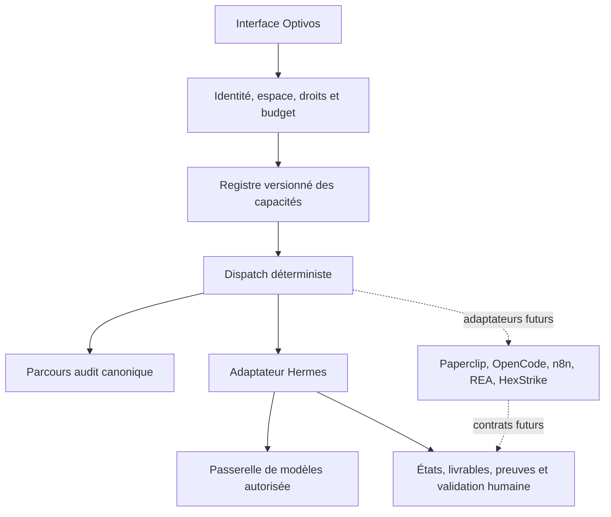

# Optivos : socle d’orchestration universelle

MISSION: ajouter une couche commune de capacités et de dispatch pour les moteurs existants et futurs.
AFFECTED DOMAIN: agent-workspace, SHADOW / Preview.
CANONICAL OWNER: Auth/Organization et registre agent-company existants ; audit canonique inchangé ; missions, preuve de coût, UUID et relectures restent au pilote Hermes.
CURRENT STATUS: socle extensible, exécution textuelle Hermes seulement ; les autres adaptateurs restent à raccorder.
FILES EXPECTED: catalogue et contrat de moteurs, frontière de dispatch, routes de workspace, bibliothèque UI, tests et cette architecture.
DB IMPACT: aucun dans cette étape ; pas de second registre d’identité ni de file dupliquée.
SECURITY IMPACT: même accès tenant, rôle d’écriture, origine et JSON borné ; aucun endpoint, secret, modèle ou outil fourni par le client ; aucun repli automatique.
TEST PLAN: refus des moteurs/capacités inconnus ou non raccordés, auteurs/droits injectés, origine, taille, tenant, UUID conservé, absence de repli et contrat d’extension ; parcours de composants et CI.
OUT-OF-SCOPE: achat, appel IA payant, activation de tous les moteurs, installation automatique de plugins, scans de cibles, modification du moteur audit, Production.

## Architecture cible

Optivos est le plan de contrôle commun, avec une interface conversationnelle et une bibliothèque de moteurs. Il possède les objectifs, autorisations, liaisons tenant/espace, validations, politiques de coût et index des preuves. Chaque système conserve son moteur et ses propres résultats. L’adaptateur traduit un contrat versionné vers l’API existante ; l’ajout d’un adaptateur ne crée pas un second système d’authentification.

| Composant     | Rôle dans Optivos                                | État du raccordement Optivos                                                                    |
| ------------- | ------------------------------------------------ | ----------------------------------------------------------------------------------------------- |
| Audit Optivos | Découverte, analyse, ROI et résultats canoniques | Parcours existant, lien direct ; pas d’exécution via le nouveau dispatch                        |
| Hermes        | Exécution de missions et capacités installées    | Adaptateur textuel gratuit ; vérification manuelle, état du service à vérifier                  |
| Paperclip     | Équipes, objectifs, délégation et gouvernance    | Adaptateur à construire ; concepts d’équipes déjà présents                                      |
| OpenCode      | Travaux sur dépôts et livrables de code          | Adaptateur serveur à construire, environnement isolé requis                                     |
| n8n           | Workflows déterministes et événements            | Adaptateur API/webhooks à construire                                                            |
| REA           | Analyse statique et preuves de code              | Utilisé pour la recherche opérateur, pas encore depuis l’interface client                       |
| HexStrike     | Outils de sécurité sur périmètre autorisé        | Connecteur disponible à l’opérateur, adaptateur client non raccordé                             |
| OpenRouter    | Fournisseur de modèles                           | Utilisé indirectement par le pilote Hermes, aucun changement de fournisseur depuis le catalogue |
| 9Router       | Passerelle de modèles compatible OpenAI          | À raccorder ; ses règles de repli devront respecter la politique Optivos                        |

Skills, plugins, API et MCP sont des modes d’extension des capacités, pas des promesses d’exécution universelle. Un skill décrit une procédure ; un plugin apporte du code et des permissions ; une API expose un contrat ; MCP transporte des outils et ressources. Un agent ne reçoit que les capacités approuvées pour son espace, avec provenance, version et droits explicites.

## Contrat et sécurité du dispatch initial

Le manifeste version 1 identifie le moteur, sa catégorie, ses capacités, protocoles possibles, état de raccordement, prérequis et référence officielle. Il ne contient aucune clé ou URL privée. Le registre valide les identifiants uniques ; l’enregistrement d’un manifeste n’installe ni n’autorise son moteur. Les manifests intégrés sont versionnés avec le code. L’import client de manifests et leur persistance viendront avec une table tenant, migration/RLS et validation administrateur ; pas de faux bouton d’installation ici.

`GET /api/atelier-ia/entreprises/:id/engines` lit le catalogue après contrôle de l’espace. Les états décrivent le raccordement applicatif, jamais la santé en direct. `POST .../:id/dispatch` accepte une enveloppe stricte version 1 : `engineId`, `capability`, `mission: {id, prompt}`. Seule `hermes / text.generate` est raccordée. Le dispatch traduit vers `freePilotCreate` qui refait les contrôles et utilise la file durable existante, sa preuve de coût nul et son auteur dérivé côté serveur. UUID et texte sont conservés ; aucune nouvelle file ni reprise automatique. Les lectures/arrêt/relectures restent aux routes existantes.

Un manifeste sans adaptateur actif est refusé. Aucun arbitrage LLM n’est requis pour cette sélection explicite. Le modèle génératif produit le travail, les règles exactes et permissions restent déterministes. Jev reste une optimisation facultative future des tâches sémantiques groupées, soumise au budget API nul ; ni appel ni clé ajoutée dans cette étape.

## Progression vers le moteur complet

1. Socle présent : registre validé, bibliothèque, enveloppe de dispatch et adaptateur Hermes existant.
2. Raccordements : endpoints privés administrés côté serveur, coffres de secrets par client, vérification manuelle des versions/capacités, adaptateurs Paperclip/OpenCode/n8n/REA/HexStrike et passerelles. Chaque adaptateur doit démontrer son lancement, son arrêt, ses preuves et son coût avant activation.
3. Missions composées : graphe d’étapes avec dépendances, validations humaines, estimation distincte du coût constaté, reprise après crash, idempotence par étape et compensation explicite. Cette persistance exigera une migration et des tests RLS ; elle n’est pas simulée dans ce socle.
4. Distribution : installation sur VPS du client en priorité, profils de capacités par entreprise, mises à jour signées et sauvegardes. Hébergement mutualisé après isolation et mesures de ressources ; modèles locaux selon RAM/CPU/GPU mesurés. Aucun gain de tokens ou de prix annoncé sans mesure.

## Sources consultées le 16 octobre 2026

- [Hermes](https://github.com/NousResearch/hermes-agent) : fournisseurs et intégration MCP.
- [Paperclip](https://github.com/paperclipai/paperclip) : organisation d’agents, objectifs et adaptateurs ; projet MIT.
- [OpenCode](https://opencode.ai/docs/server/) : interface serveur à adapter.
- [9Router](https://github.com/decolua/9router) : passerelle compatible OpenAI et replis configurables ; ses annonces de gratuité et d’économie ne sont pas des mesures Optivos.
- [OpenRouter](https://openrouter.ai/docs/api/reference/overview) : fournisseur utilisé via le pilote, distinct de la couche d’orchestration.
- [HexStrike](https://github.com/0x4m4/hexstrike-ai) : interface MCP et outils de sécurité.
- [REA](https://github.com/morluto/rea) : package opérateur `rea-agents` 6.4.0 vérifié sur le VPS ; adaptateur client Optivos à construire.
- [n8n](https://github.com/n8n-io/n8n) et [modèle de licence](https://github.com/n8n-io/n8n/blob/master/LICENSE.md) : moteur de workflows à conditions de redistribution distinctes de MIT. L’offre hébergée/embarquée vendue avec Optivos devra être confrontée à ces conditions avant commercialisation ; aucun abonnement n’est autorisé par cette note.

La disponibilité d’un outil dans le chat opérateur ou sur le VPS ne signifie pas qu’il est installé, autorisé ou isolé pour chaque client d’Optivos.

## Vérification du socle livré

81 tests ciblés, dont huit nouveaux cas sur la frontière de dispatch et le contrat d’extension ; 24 contrôles UI de composants avec réponses HTTP de recette. Les tests couvrent accès tenant/rôle, origine, JSON borné, paramètres injectés, moteurs/capacités inconnus, moteurs non raccordés, auteur dérivé côté serveur, UUID conservé, refus sans repli, catalogue sans appel moteur et retour au composeur. TypeScript, ESLint et formatage vérifiés. Captures ordinateur/mobile inspectées. Les commandes du catalogue ne lancent aucune installation ; la préparation Hermes n’envoie aucune mission.

La recette navigateur avec le compte propriétaire sur le staging et un nouveau lancement réel via `/dispatch` restent NOT RUN. La couche délègue à l’adaptateur Hermes déjà existant, vérifié avec un transport mocké ; elle ne constitue pas une nouvelle preuve d’inférence réelle. Aucun appel IA, nouvelle clé, nouvelle dépendance, migration ou changement du service VPS dans cette étape.
